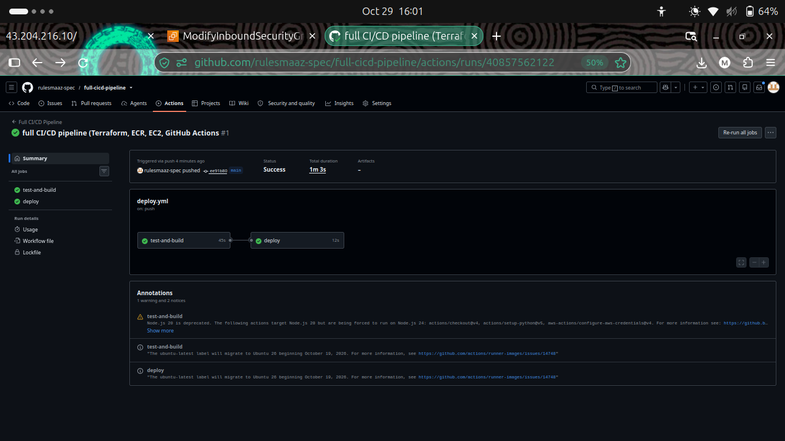
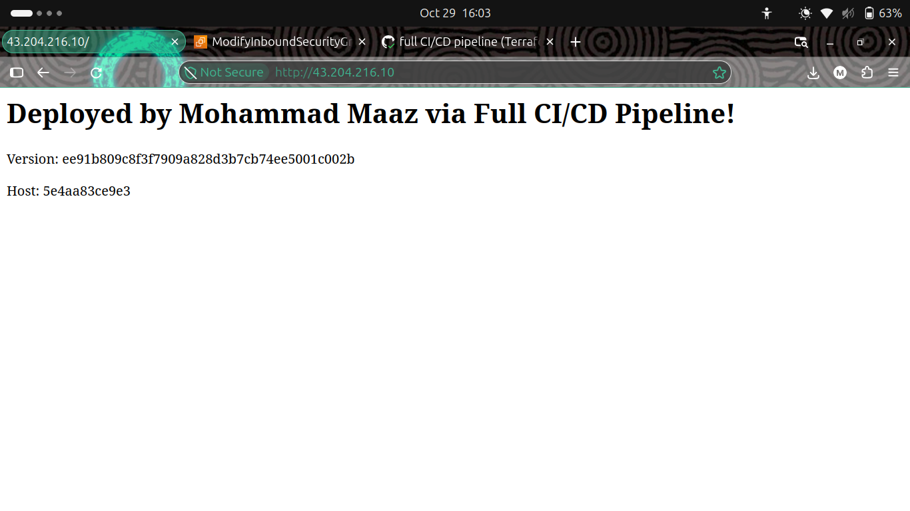
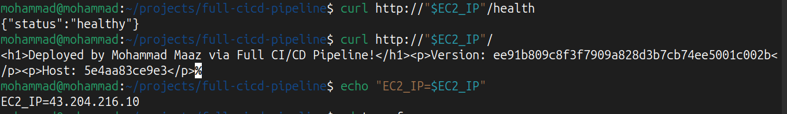
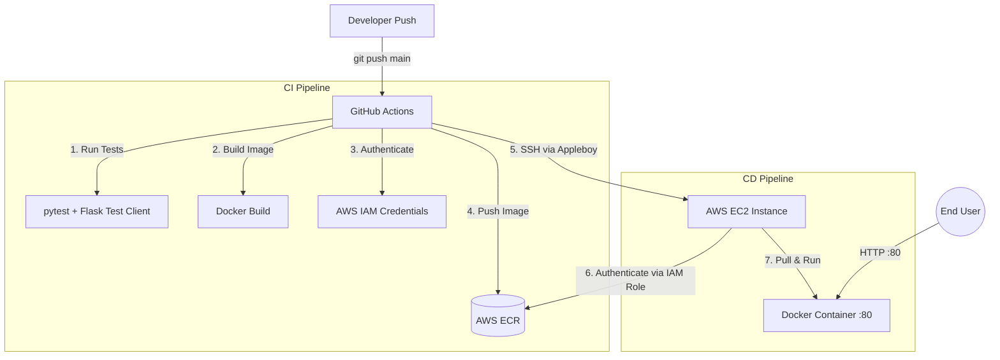

# Full CI/CD Pipeline — Terraform · AWS · Docker · GitHub Actions

## What it does and why it exists

**What it does:**
This project is a fully automated CI/CD assembly line. When a developer pushes code to the `main` branch, the pipeline automatically tests the code, builds a Docker image, pushes it to AWS ECR, and securely deploys it to a live AWS EC2 server. Zero manual commands are run on the server.

**Why it exists:**
Before automated pipelines, deploying software was a manual, error-prone process (using FTP, manual SSH, and hardcoded passwords) that often led to downtime and the classic "it works on my machine" problem. 

This project exists to solve those real-world engineering problems:
* **Eliminating Human Error:** The pipeline runs the exact same deployment steps every single time. It is incapable of making typos.
* **Environment Consistency:** By using Docker, the application runs in the exact same environment on the developer's laptop as it does on the AWS server.
* **Security by Design:** It eliminates hardcoded passwords by using GitHub Secrets and AWS IAM Roles to securely authenticate between services.
* **Deployment Traceability:** Every Docker image is tagged with the Git Commit SHA (`${{ github.sha }}`). We never use the `:latest` tag, meaning we always know the exact version of the code running in production.

## Demo

*Screenshot: GitHub Actions showing successful test, build, and deploy jobs.*


*Screenshot: The Flask application running live on the AWS EC2 instance.*


*Screenshot: Showing output via terminal.*

## How is it built?

### Architecture Diagram

## CI/CD Pipeline Flow

1. **Trigger:** A developer pushes code to the `main` branch.
2. **Continuous Integration (CI):** GitHub Actions runs `pytest` to ensure the app is healthy, then builds the Docker image.
3. **Artifact Storage:** The image is tagged with the Git Commit SHA and pushed to **AWS ECR**.
4. **Continuous Deployment (CD):** GitHub Actions securely SSHes into the **AWS EC2** instance.
5. **Container Swap:** The EC2 instance authenticates via its IAM Role, pulls the new image, stops the old container, and starts the new one on port 80.
6. **Live:** The new version is available to the end user.

## Tech Stack
| Area | Tools |
|---|---|
| Cloud | AWS (VPC, EC2, RDS, ALB) |
| IaC | Terraform |
| CI/CD | GitHub Actions |
| Containers | Docker |

## Project Features

### 🚀 CI/CD & Automation
* **Zero-Touch Deployment:** Fully automated pipeline from `git push` to a live AWS EC2 instance without any manual server commands.
* **Pipeline Gating:** The deployment job will only trigger if the application tests pass successfully.
* **Immutable Deployments:** Docker images are tagged using the Git Commit SHA (`${{ github.sha }}`), completely eliminating the `:latest` tag problem and ensuring perfect deployment traceability.
* **Automated Cleanup:** The deployment script automatically runs `docker image prune` to prevent the EC2 server's disk from filling up with old images.

### 🏗️ Infrastructure as Code (IaC)
* **100% Terraform Provisioned:** All AWS resources (EC2, ECR, IAM, Security Groups) are defined as code.
* **Dynamic AMI Lookup:** Uses Terraform `data` blocks to always fetch the most recent Ubuntu 22.04 AMI, ensuring the server is always up-to-date.
* **Automated Server Bootstrapping:** Utilizes EC2 `user_data` to automatically install Docker and the AWS CLI the moment the server spins up.

### 🔒 Security (DevSecOps Mindset)
* **Least Privilege Access:** The EC2 server does not use hardcoded AWS credentials. It uses an **IAM Instance Profile** with strictly scoped `AmazonEC2ContainerRegistryReadOnly` permissions to pull images.
* **Secret Management:** AWS keys and SSH private keys are securely stored in **GitHub Secrets** and injected at runtime; no secrets exist in the source code.
* **Container Hardening:** The Dockerfile creates a dedicated, **non-root user** (`appuser`) to run the application, mitigating container breakout risks.
* **Health Monitoring:** The Docker image includes a native `HEALTHCHECK` instruction that continuously pings the Flask `/health` endpoint to ensure the app is responsive.

### 🐳 Application & Containerization
* **Production-Ready WSGI:** The Python Flask application is served using **Gunicorn**, not the Flask development server, making it production-capable.
* **Multi-Stage Dockerfile:** Features a `python:3.11-slim` base image to keep the container lightweight and secure.
* **Environment Variables:** The application dynamically reads the `APP_VERSION` environment variable, displaying the Git SHA on the live webpage to visually prove which version is running.

## Getting Started

### Prerequisites
- Docker, Terraform, AWS CLI (versions)

### Run locally
```bash
git clone https://github.com/USERNAME/REPO.git
cd REPO
cp .env.example .env
docker compose up
```
Open http://localhost:8080

## Project Structure
```
.
├── app/
├── terraform/
├── .github/workflows/
└── docs/
```
## CI/CD Pipeline
git push ──> pytest ──> docker build ──> docker push (ECR) ──> ssh (EC2) ──> docker pull ──> docker run ──> Live App 🚀

## Security Decisions
- No secrets in the repo, credentials come from GitHub Secrets
- Non-root container user
- Least-privilege IAM

## What I Learned
- A real problem you hit and how you fixed it
- A trade-off you made and why

## Future Improvements
- Honest list of next steps

## Author
**Mohammad Maaz**, DevOps / Cloud Engineer (Fresher)